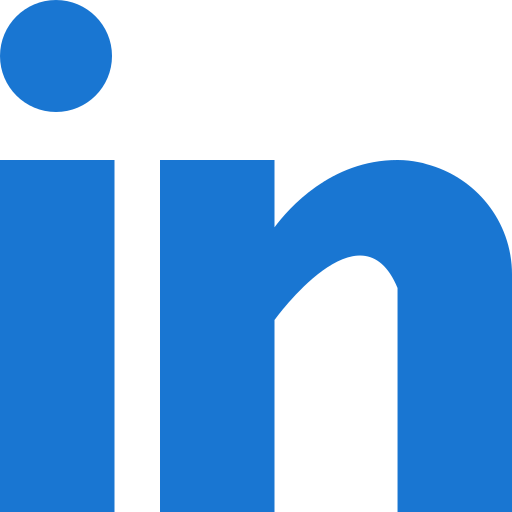

<h1 align="center">👋 Hi there, I'm <a href="https://jessmathews.github.io/">Jess</a></h1>

 
 

<!--
- 🔭 I’m currently trying to start with **open source contributions**

- 🌱 I’m currently learning **Data Structures** and **Algorithms**

- 👯 I’m looking to collaborate on **FOSS projects**

- 🗨️ Ask me about **Fullstack Development**

-->

 
<h2 align="center">🛠️ Tools and Languages:</h2>

  

 

<h2 align="center">🙋‍♂️Connect:</h2>
 

  

 
 

<h2 align="center"> Stats:</h3>
 
<table>
<tr>
<td>

</td>
<td>

</td>
<td>

</td>
</tr>
</table>

 
<h2 align="center">🏆 Trophies:</h2>
 

<!-- add projects to repo -->
<!-- make three.js website-->
<!--### Hi there 👋
**jessmathews/jessmathews** is a ✨ _special_ ✨ repository because its `README.md` (this file) appears on your GitHub profile.

Here are some ideas to get you started:

- 🔭 I’m currently working on ...
- 🌱 I’m currently learning ...
- 👯 I’m looking to collaborate on ...
- 🤔 I’m looking for help with ...
- 💬 Ask me about ...
- 📫 How to reach me: ...
- 😄 Pronouns: ...
- ⚡ Fun fact: ...
-->
